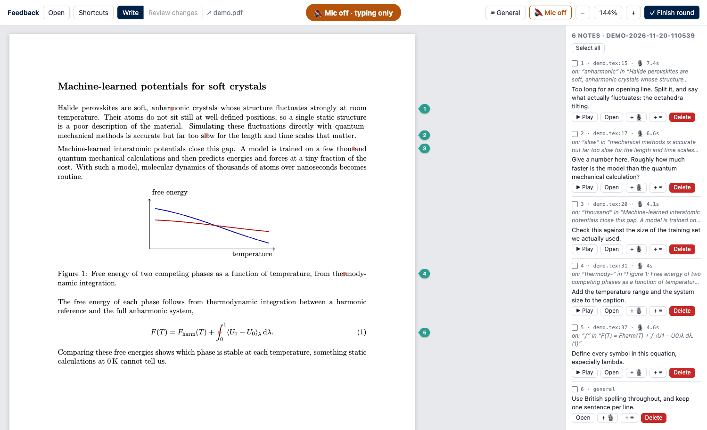
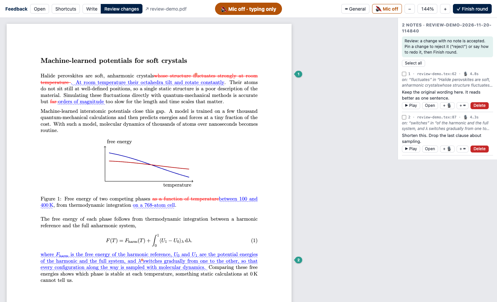

# Feedback reader

[](https://github.com/TFL600/feedback-reader/actions/workflows/tests.yml)

Click a spot in a PDF, say what you think, and an agent applies the edits.



## Why

I think out loud better than I type. When I reviewed my own drafts (thesis chapters, paper drafts,
a CV, emails), writing review comments was the slow step: I knew what was wrong with a sentence long
before I had typed a comment saying so. Speaking is faster, but a voice memo loses where in the
document each remark belongs.

The reader keeps both: every spoken comment is pinned to the exact spot it is about.

The same goes for **long AI outputs that need your decisions**. Turn the output into a PDF, click the
sentence you are answering and speak. No copying the passage first, and no doubt about which point
a reply belongs to.

## What it does

1. **Click and speak.** Open a PDF, click on a word and talk. The mic stays open for the whole
   session, so recording starts the moment you click. Typing works too, for days in a busy office,
   and so do general remarks with no anchor.
2. **Local transcription.** Each clip is transcribed on your own machine with
   [whisper.cpp](https://github.com/ggml-org/whisper.cpp), in the background while you carry on.
   Nothing leaves the laptop. A small dictation dictionary biases Whisper towards your jargon and
   fixes words it keeps mishearing.
3. **Notes pinned to text.** Each note keeps its page, its position, the line of PDF text under the
   click and the word clicked.
4. **Mapped to the source.** For a LaTeX document compiled with `-synctex=1`, every pin is mapped
   to its `.tex` file and line through SyncTeX, then corrected to the sentence actually clicked.
5. **An agent applies your spoken feedback.** *Finish round* copies a command such as
   `/apply-feedback <round>` to the clipboard. Pasted into [Claude Code](https://claude.com/claude-code),
   the agent reads a compact `feedback.md` (a few thousand tokens for 30 notes, never audio), makes
   the edits, asks only about the ambiguous ones and logs every before/after pair.
6. **Review the changes, and give feedback on them.** `reader/review.py` builds a red/blue PDF of
   what the agent changed and switches the reader to it. No note on a change accepts it. A note on
   it ("keep the original wording", or a new instruction) goes into the next round, so the loop
   continues until the draft is right.



It also works on PDFs that are not LaTeX (a Word export, a co-author's draft, an AI answer): notes
still carry the clicked text, so the agent can find the passage.

## Quick start

Built for macOS. Linux possible (untested). Needs Python 3.10+ (standard library only), Chrome or another browser with a
microphone, [whisper.cpp](https://github.com/ggml-org/whisper.cpp) and ffmpeg. LaTeX is optional.

```bash
brew install whisper-cpp ffmpeg
mkdir -p ~/.cache/whisper
curl -L -o ~/.cache/whisper/ggml-large-v3-turbo.bin \
  https://huggingface.co/ggerganov/whisper.cpp/resolve/main/ggml-large-v3-turbo.bin
git clone https://github.com/TFL600/feedback-reader.git
cd feedback-reader/examples && latexmk -pdf -synctex=1 demo.tex
../bin/open-reader demo.pdf
```

`open-reader` starts the server on http://127.0.0.1:8765 (bound to localhost only) and opens a tab.
Run it with no argument for the review queue: rounds in progress, PDFs rebuilt since their last
round, and PDFs not reviewed yet. Or drop a PDF onto the page, or paste its path.

Keyboard shortcuts: click to pin and record, **Enter** saves, **Esc** discards, **G** a general
remark, **T** a typed note, **M** mic on or off, **F** finish the round.

**Two documents to try.** `examples/demo.tex` is the page in the screenshots: click anywhere and
comment. `tests/targets.tex` is a guided round: build it the same way, follow the blue boxes (click
this word, say this sentence), finish the round, then run `python3 tests/eval.py tests/targets.tex`.
It scores every note: did the pin land on the right source line and word, and did Whisper hear what
you said.

To let Claude Code apply your rounds, run `./install.sh`. It shows what it will add to
`~/.claude/skills/` and asks before doing anything.

## Configuration

Settings are optional. Put them in `~/.feedback-reader/config.env` as `KEY=value` lines, or set
them as environment variables (full list in [reader/config.py](reader/config.py)). Personal settings
stay outside the repo.
The ones worth knowing: `FR_PROJECT` (a LaTeX project whose PDFs get source lines and review diffs),
`FR_HOME` (where rounds are kept, default `~/.feedback-reader`), `FR_WHISPER_MODEL` and
`FR_DICTIONARY` (see [dictionary.example.md](dictionary.example.md)).

## What is in here

| Path | What |
| --- | --- |
| `reader/server.py` | the local server: tabs, rounds, notes, background transcription |
| `reader/index.html` | the whole front end, one file, PDF.js from a CDN |
| `reader/process.py` | finishes a round: transcripts, source lines, `feedback.md` |
| `reader/glossary.py` | jargon from the project's `.tex` files (or any PDF) to prompt Whisper with |
| `reader/review.py` | red/blue latexdiff PDF of the agent's changes |
| `bin/open-reader` | start the reader if needed and open a PDF in the right tab |
| `bin/md-to-reader`, `bin/email-to-reader` | render markdown drafts (or one email per page) to PDF and open them |
| `bin/whisper-transcribe` | headless whisper.cpp for one clip |
| `bin/dictation` | the dictation dictionary: Whisper prompt, corrections, `add-term`, `add-fix` |
| `skills/apply-feedback` | the Claude Code skill that applies a round, installed by `install.sh` |
| `examples/demo.tex` | the one-page document in the screenshots |
| `tests/test_reader.py` | unit and integration tests, standard library only, run on every push |
| `tests/eval.py` + `tests/targets.tex` | the guided round, and the script that scores it |

## Design notes

- **Text, not audio, reaches the agent.** Transcription happens locally, and the agent only sees
  `feedback.md`. That keeps a round cheap and keeps recordings private. It also means any model can
  apply the feedback, including one hosted locally or an open-source one, and so can you, by hand.
- **One sentence per source line.** SyncTeX resolves to a printed line, not a word. With one
  sentence per line in the `.tex`, the clicked word picks out the exact sentence.
- **Nothing is lost.** Notes are saved and transcribed as you go, every PDF version a round was made
  on is kept, and a failed save says so on screen.
- **The dictionary learns.** When the agent spots a misheard term it adds a correction, so the
  same mistake is fixed in every later round.

## Where it came from

The reader is the successor to [EditComments](https://github.com/TFL600/EditComments), a macOS
menu-bar app for typed review tags in text drafts. Speaking at the exact spot turned out to be a
much better way to review. EditComments stays the lightweight option: typed only, no PDF and nothing
to install beyond the app, so it works anywhere, even on a plane.

MIT licence.
